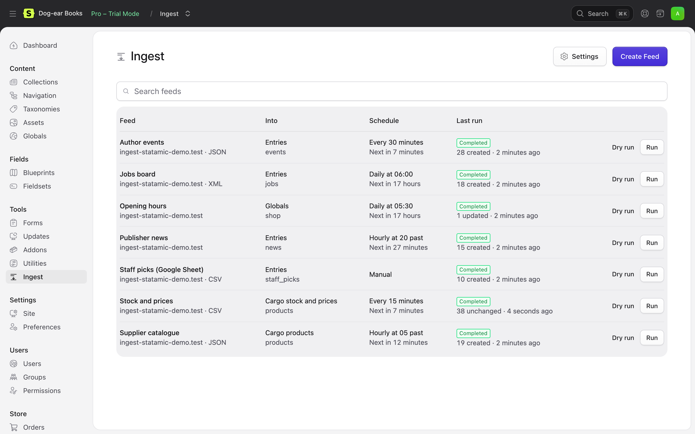
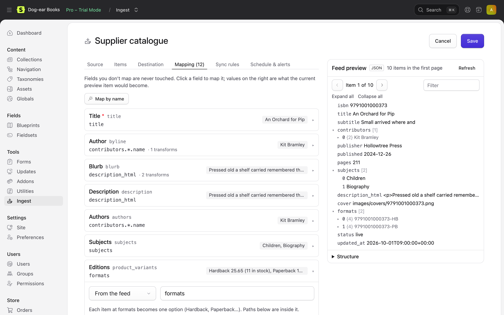
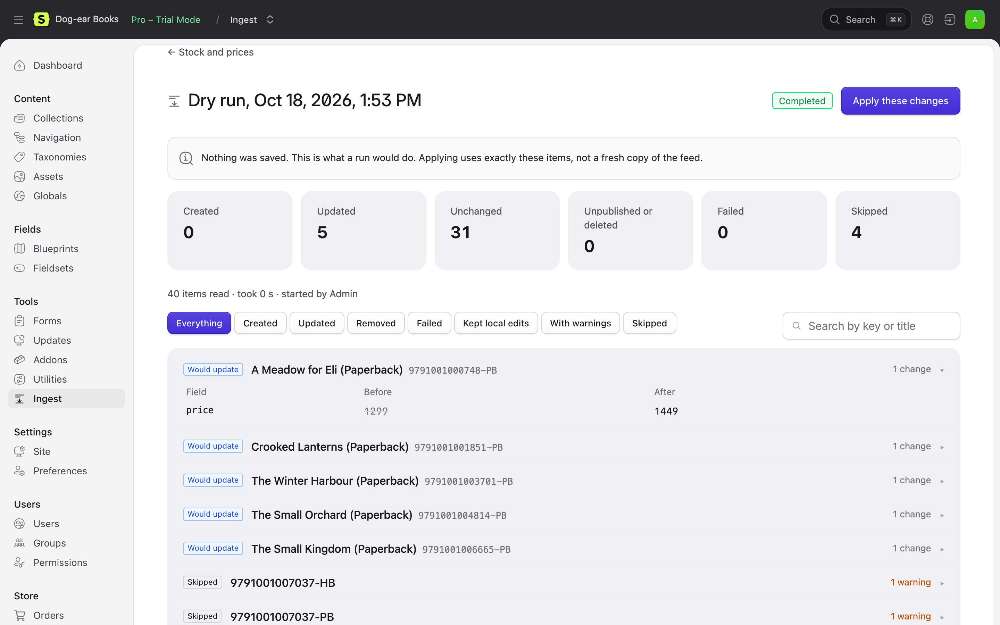

# Ingest for Statamic

Keep Statamic in step with the feeds you don't control: supplier catalogues, stock files, property listings, job boards, ticketing APIs, spreadsheets and RSS. Ingest reads them on a schedule, changes only what changed, and lets you preview and undo every run.

Moving a site from WordPress once? Statamic's official [Importer](https://github.com/statamic/importer) does that well. Ingest is for the feeds that keep coming: the same feed, every hour, kept in sync.

## Features

- **Any feed.** JSON, JSON Lines, XML, RSS, Atom, CSV/TSV and Rightmove BLM, from a URL or API (bearer tokens, API keys, basic auth, OAuth 2), an uploaded file, a file on the server, or a Google Sheet. Five kinds of pagination. Big files are streamed, not loaded whole.
- **Into anything.** Entries, taxonomy terms, globals and users, and with [Cargo](https://statamic.com/addons/duncanmcclean/cargo): products with variants, prices and stock, plus a fast stock-and-price feed matched by SKU.
- **Real mapping.** Every fieldtype, including Bard, Replicator, Grid and Group; relationships that find or create entries and terms; images downloaded once and shared; dates, toggles and options that understand what feeds actually send. Transforms, templates, and Statamic's own modifiers.
- **Sync, not just import.** A key matches feed items to content. Only fields you map are touched, unchanged items aren't saved again, and items that leave the feed can be left, unpublished or deleted. Edits made on the site can be kept.
- **Safe to leave running.** Dry runs show every change field by field, and apply exactly what you previewed. Every run can be undone. A feed that comes back empty, broken or half-missing never wipes your content. Failures email you (and Slack) once, not every 15 minutes.
- **In the Control Panel.** Set feeds up with a live preview of the real feed beside the mapping, watch runs as they go, and see what each one did. A dashboard widget shows which feeds need attention.
- **For developers.** Feeds are YAML files that deploy with the site (or database rows), with commands, a webhook, events, per-feed PHP hooks, and your own sources, formats, destinations and transforms.

| Feeds | The feed form | A dry run |
|---|---|---|
|  |  |  |

There's a demo shop, [Dog-ear Books](docs/demo.md), that keeps its catalogue, stock, events, news, jobs and opening hours in step with seven feeds.

## Requirements

- PHP 8.3 or later
- Statamic 6.35 or later (Laravel 12 or 13)
- A cron entry for Laravel's scheduler, for scheduled feeds
- A queue worker is recommended for large feeds (Ingest also runs without one)
- Cargo 1.15 or later, only for the Cargo features

## Installation

```bash
composer require 1994/ingest-statamic
```

That's it for the file driver (the default). For the database driver, see [Storage](docs/configuration.md#storage).

Then go to **Tools → Ingest** and create your first feed, or read the [quick start](docs/quick-start.md).

## Documentation

Everything is in [docs/](docs/README.md): sources, formats, mapping and field types, sync rules, safety, scheduling, Cargo, Google Sheets, the PHP API, and recipes for supplier feeds, estate agents, job boards, ticketing APIs, Sheets as a CMS and RSS.

## Support

Email [hello@1994.co.uk](mailto:hello@1994.co.uk), or open an issue on GitHub.

## Licence

Ingest is commercial software. You need a licence from the [Statamic Marketplace](https://statamic.com/addons) to use it in production. See [LICENSE.md](LICENSE.md).
