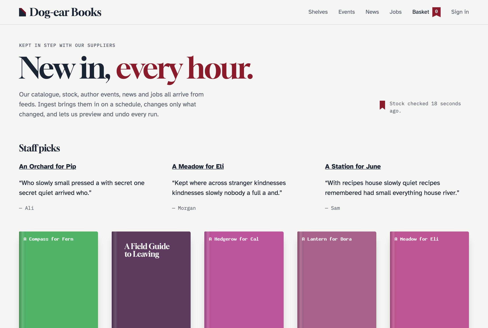

# The demo shop

[Dog-ear Books](https://github.com/1994limited/ingest-statamic-demo) is a small bookshop built on Statamic and Cargo whose catalogue, stock, events, news, jobs, staff picks and opening hours all arrive from feeds. It includes a **feed lab**: made-up feeds served by the site itself, with switches to make them change, break or slow down, so you can see every part of Ingest without a real supplier.



## Running it

```bash
git clone https://github.com/1994limited/ingest-statamic-demo.git
cd ingest-statamic-demo
composer install
cp .env.example .env
php artisan key:generate
touch database/database.sqlite
php artisan migrate
php artisan demo:users
```

Serve it with Herd or Valet at `ingest-statamic-demo.test` (the feed lab and the feeds use that address), and set `INGEST_HTTP_VERIFY` in `.env` to your local certificate authority (Herd: `~/Library/Application Support/Herd/config/valet/CA/LaravelValetCASelfSigned.pem`). Sign in to the Control Panel at `/cp` as `admin@example.com` with the password `password`.

## The feeds

| Feed | From | Into | Shows |
|---|---|---|---|
| Supplier catalogue | A paginated JSON API | Cargo products with editions | Pagination, variants, covers, authors and subjects created, filters, set-once prices |
| Stock and prices | A CSV by SKU | Cargo stock and prices | Fast updates matched by SKU |
| Author events | A JSON API with a bearer token and cursor pages | Events | Secrets in `.env`, dates, cancelled events unpublished |
| Publisher news | RSS | News | RSS fields, images |
| Jobs board | XML | Jobs | XML item paths, closed jobs unpublished |
| Staff picks | A Google-Sheets-style CSV | Staff picks | Relationships matched on ISBN, deleting removed rows |
| Opening hours | One JSON object | The Shop globals | Globals, a Grid |

Run them all:

```bash
php artisan ingest:run supplier_catalogue author_events publisher_news jobs opening_hours
```

The catalogue then runs the stock feed and the staff picks.

## Making the supplier change

```bash
php artisan demo:feed-lab books v2       # prices change, a title changes, one book goes, one arrives
php artisan demo:feed-lab books v3       # a cover changes
php artisan demo:feed-lab books empty    # an empty catalogue: the safety check stops it
php artisan demo:feed-lab books broken   # a sign-in page instead of the feed: the run fails
php artisan demo:feed-lab books error    # a 503: the run fails, and an email goes to shop@example.com
php artisan demo:feed-lab books slow     # a three-second response
php artisan demo:feed-lab books v1       # back to the start
```

After each, try a **Dry run** of the catalogue in the Control Panel, apply it, and undo it.

## Starting again

```bash
php artisan demo:reset
```

removes everything the feeds imported and their history.

Everything in the demo is made up, from the books to the publishers.
