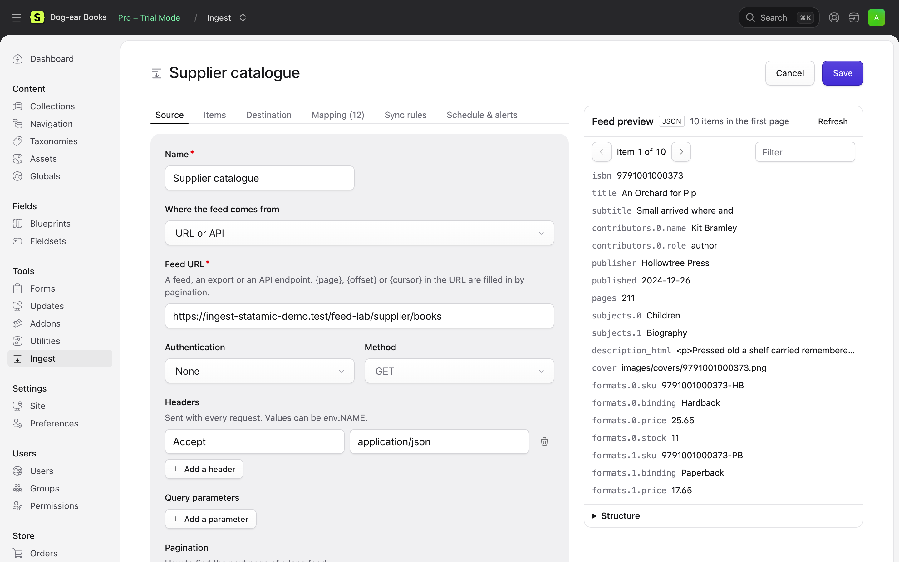

# Sources

Where a feed comes from. Choose it under **Source** on the feed form.



## A URL or an API

Any feed, export or API endpoint over HTTP(S). In the feed's YAML:

```yaml
source:
  type: url
  url: 'https://supplier.example/api/v2/books'
  method: GET            # or POST, with body
  headers:
    Accept: application/json
  query:
    status: live
```

Ingest asks the server whether the feed has changed since the last successful run (`If-None-Match` and `If-Modified-Since`). When it hasn't, the run ends at once with "The feed hasn't changed since the last run".

### Authentication

| Type | Settings | Sends |
|---|---|---|
| `bearer` | `token` | `Authorization: Bearer …` |
| `api_key` | `name`, `value`, `in` (`header` or `query`) | `X-API-Key: …` or `?api_key=…` |
| `basic` | `username`, `password` | `Authorization: Basic …` |
| `oauth2` | `token_url`, `client_id`, `client_secret`, `scope` | Fetches a client-credentials token, keeps it until shortly before it expires, and sends it as a bearer token |

### Secrets stay in .env

A token, password, key or client secret is never saved with the feed. Write `env:` and the name of an environment variable instead, and put the value in `.env` on each server:

```yaml
source:
  auth:
    type: bearer
    token: 'env:SUPPLIER_TOKEN'
```

```env
SUPPLIER_TOKEN=abc123
```

The form refuses a secret typed in directly, and shows whether each variable is set (never its value). Header and query values can be env references too. Ingest reads `.env` itself when config is cached, so `php artisan config:cache` doesn't break them.

### Pagination

For feeds split across pages, choose how to find the next one:

| Type | Settings | Example |
|---|---|---|
| `next_url` | `path`: where the link is | `{"links": {"next": "…?page=2"}}`. Relative links work |
| `link_header` | none | `Link: <…?page=2>; rel="next"` (GitHub, Shopify, many REST APIs) |
| `page` | `param` (default `page`), `start` (default 1), `size`, `size_param`, `last_page_path`, `total_path` | `?page=2`, or `{page}` in the URL: `…/books/{page}.json` |
| `offset` | `param` (default `offset`), `size`, `size_param`, `total_path` | `?offset=50&limit=25`, or `{offset}` in the URL |
| `cursor` | `path`: where the next cursor is; `param` (default `cursor`); `has_more_path`; `first` | `?cursor=abc123`, or `{cursor}` in the URL |

Every type also has `max_pages` (default 500). Page and offset pagination stop on an empty page, or when a last page or total says so. A run that stops at `max_pages`, or loops back to a page it has already read, says so and is treated as incomplete: nothing is unpublished or deleted as [missing](sync-rules.md#items-missing-from-the-feed).

```yaml
source:
  type: url
  url: 'https://tickets.example/api/events'
  auth:
    type: bearer
    token: 'env:TICKETS_TOKEN'
  pagination:
    type: cursor
    path: next_cursor
    param: cursor
```

## An uploaded file

Choose **Uploaded file** and upload JSON, XML, RSS, CSV or BLM. The file is kept privately in `storage/ingest/uploads/{feed}/`, not in a public folder. Upload a new one whenever it changes and run the feed. Running it again with the same file does nothing.

## A file on the server

For exports an ERP or supplier drops by FTP or SFTP:

```yaml
source:
  type: path
  path: '/home/forge/drops/stock.csv'
  archive: true     # move it into an "archive" folder beside it after a successful run
```

Only folders listed in `ingest.server_paths` can be read (by default `storage/ingest/drops`), so a feed can't be pointed at the site's `.env` or anything else on the server. A file that's the same as last time is skipped.

## Google Sheets

Paste the sheet's share link. See [Google Sheets](google-sheets.md).

## Your own source

Anything else (an SFTP server, a database, a vendor's SDK) can be a source class. See [the PHP API](php-api.md#your-own-source).
