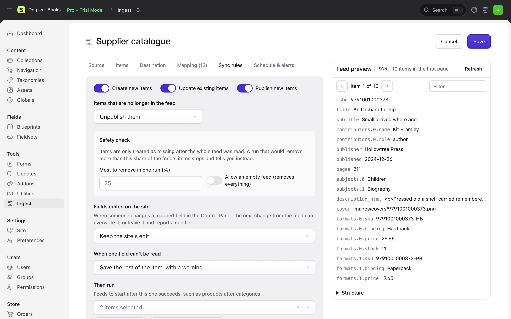

# Sync rules

The **Sync rules** tab says what a run may do.



```yaml
sync:
  create: true
  update: true
  publish_new: true
  missing:
    action: unpublish        # leave, unpublish or delete
    delete_after_days: null
  safety:
    max_removal_percent: 25
    allow_empty: false
  local_edits: overwrite     # overwrite or keep
  on_field_error: save_rest  # save_rest or skip_item
```

## Creating and updating

- **Create new items**: off, and items not on the site yet are skipped (for a feed that only updates content made elsewhere).
- **Update existing items**: off, and items already on the site are left as they are (a feed that only adds).
- **Publish new items**: off, and new entries are drafts for an editor to check.

## Items missing from the feed

When an item the feed created is no longer in it (sold out for good, a property let, a job closed, or filtered out):

| Action | |
|---|---|
| Leave them | Nothing happens (the default) |
| Unpublish them | Unpublished, and published again if they come back |
| Delete them | Deleted. With **delete after N days**, unpublished first and deleted only if they're still missing after that long |

Users are blocked rather than unpublished. Globals and stock feeds never remove anything.

### The safety check

Removing content because a feed says so is where imports go wrong, so Ingest is careful:

- Items only count as missing after the **whole feed was read**: every page, and no item limit. A feed that failed halfway, stopped at its page limit, or was run with a limit never unpublishes or deletes anything.
- A feed that comes back **empty** stops: nothing is removed. Tick **Allow an empty feed** if empty really means "remove everything".
- A run that would remove more than **25%** of the feed's items (`max_removal_percent`, set per feed or in the settings) stops before removing anything and is marked **Stopped by safety check**, with an email if you've asked for one. Check the feed; if it's right, run it with **Ignore the safety limit**.
- Only content **this feed created or adopted**, in **this feed's site**, is ever removed.
- Every deletion is **snapshotted**, so [undo](dry-runs-and-undo.md#undo) can recreate it.

## Fields edited on the site

When someone edits a mapped field in the Control Panel:

- **The feed wins** (`overwrite`, the default): the next change from the feed replaces the edit.
- **Keep the site's edit** (`keep`): Ingest notices the field no longer has the value it wrote, leaves it, and lists it in the run as **kept local edit**. Other fields still update.

Edits are only noticed when the feed's value changes; an unchanged item isn't touched either way. For a field the site should always own after the first import, use [set once](mapping.md#set-once).

## When one field can't be read

- **Save the rest of the item** (`save_rest`, the default): the field is left as it is and the run shows a warning.
- **Leave the whole item out** (`skip_item`): the item fails.

## Limits

`sync.limit` (or **Only the first … items** under **Run with options**) reads only that many items: handy while setting a feed up. A limited run never removes anything.
